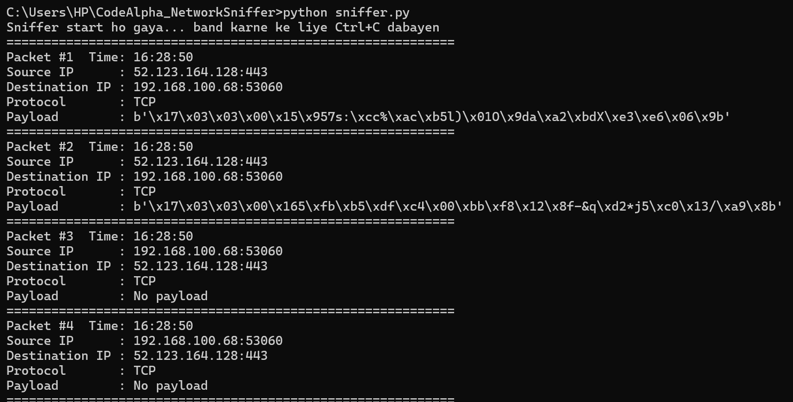

# CodeAlpha_NetworkSniffer

A basic network sniffer built in Python using the Scapy library. It captures live network packets and displays useful information such as source/destination IP addresses, ports, protocols and payload data.

## Features

- Captures live network traffic
- Shows source and destination IP with ports
- Identifies protocols (TCP, UDP, ICMP)
- Displays the first 50 bytes of payload
- Saves a short log of packets to `packets_log.txt`

## Requirements

- Python 3.x
- Scapy
- Npcap (Windows only, install in WinPcap API-compatible mode)

## Installation

```
pip install scapy
```

## Usage

Run the script as Administrator:

```
python sniffer.py
```

Press `Ctrl + C` to stop the sniffer.

## Sample Output



## How It Works

- `sniff()` captures packets from the network and passes each one to `process_packet()`.
- The function checks the IP, TCP, UDP and ICMP layers to find the protocol.
- The `Raw` layer contains the actual payload data.
- Most websites use HTTPS, so payloads appear as encrypted bytes (TLS data starting with `\x17\x03\x03`). This is expected.

## Disclaimer

This tool is for educational purposes only. Use it only on your own network or devices you have permission to monitor.

## Author

Muhammad Hasnain Lakhai - CodeAlpha Cyber Security Internship
